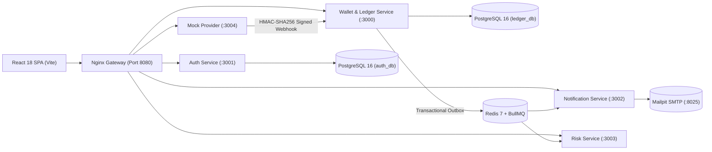

# Payora (৳) - Digital Wallet & Double-Entry Ledger Engine

[](https://github.com/ZamanAsad007/Payora/actions/workflows/ci.yml)
[](https://github.com/ZamanAsad007/Payora/actions/workflows/secret-scan.yml)
[](#)
[](#)

Payora is a financial-grade digital wallet and double-entry ledger platform inspired by modern mobile financial services (MFS such as bKash/Nagad). Users hold balances in Bangladeshi Taka (stored as integer poisha), top up funds, send peer-to-peer transfers, pay merchants via QR codes, and cash out via agent networks.

Built with an obsession for **correctness under high concurrency**: money is mathematically conserved, retries never double-charge, deadlock cycles are impossible, and every single poisha is provably auditable.

> **Disclaimer:** This is an educational and portfolio project. It operates exclusively with **fake money and fake data**. Never input real national identification numbers, real phone numbers, real bank accounts, or payment card details.

---

## 1. System Architecture



### Microservice Roles

| Service | Port | Responsibilities |
|---|---|---|
| **`gateway`** | `8080` | Nginx reverse proxy, security headers, global 10 req/s rate-limiting, and static SPA serving. |
| **`ledger-service`** | `3000` | Double-entry accounts, journal entries, immutable lines, deterministic row locking, P2P, merchant payments, cash-out, reversals, automated reconciliation, and statement exports (PDF/CSV). |
| **`auth-service`** | `3001` | User registration, login, JWT issuance, sliding token refreshes, 5-digit transaction PIN verification with lockout, and device fingerprinting. |
| **`risk-service`** | `3003` | Real-time asynchronous transaction fraud rules (velocity spikes, anomalous amounts, first-time payees, untrusted devices) and automatic account freeze triggers. |
| **`notification-service`** | `3002` | Multi-channel event dispatcher (In-App inbox, Mailpit SMTP emails, mock SMS) with strict phone number PII masking (`+88017****5678`). |
| **`mock-provider`** | `3004` | Simulates external banking clearing networks with HMAC-SHA256 signed webhook callbacks, timestamp replay tolerance, and failure injections. |
| **`frontend`** | `5173 / 80` | React 18 single-page application with TanStack Query, PIN modals, transaction receipts, statement generator, and full admin dashboard. |

---

## 2. Double-Entry Ledger Principles

### 2.1 Core Rules
1. **Double-Entry Balance Invariant:** Every financial transaction creates 1 `journal_entry` and 2 or more `ledger_lines`. Total Debits must strictly equal Total Credits:
   $$\sum \text{Debits} \equiv \sum \text{Credits}$$
2. **Append-Only Immutability:** Ledger lines can **never** be edited or deleted. Database-level `BEFORE UPDATE OR DELETE` triggers raise exceptions on any mutation.
3. **No Negative Balances:** User and merchant wallets have DB `CHECK (balance >= 0)` constraints and pre-lock balance checks.
4. **Derivable Balances & Reconciliation:** Account balances are cached for read performance and updated atomically with ledger lines. An automated reconciliation job verifies that $\text{Cached Balance} = \sum (\text{Credits} - \text{Debits})$ across all accounts.
5. **Compensating Reversals:** Transactions are never deleted. Administrative reversals create a compensating entry with debits and credits inverted, linked via `reverses_entry_id`.

### 2.2 Account Model

| Account Type | Normal Side | Description |
|---|---|---|
| `USER_WALLET` | Liability | User balances available for spending |
| `MERCHANT_WALLET` | Liability | Merchant balances accumulated from customer purchases |
| `SYSTEM_BANK_CLEARING` | Asset | Clearing account representing external funds entering the system |
| `SYSTEM_FEE_REVENUE` | Revenue | Platform revenue accrued from transfer and cash-out service fees |
| `SYSTEM_AGENT_CASH` | Asset | Clearing account representing physical cash held by agent network |

---

## 3. Transaction Entry Examples (Amounts in Poisha)

### 3.1 Wallet Top-Up (৳ 500.00 = 50,000 Poisha)
| Account | Direction | Amount |
|---|---|---|
| `SYSTEM_BANK_CLEARING` | **DEBIT** | 50,000 |
| `USER_WALLET` (Alice) | **CREDIT** | 50,000 |

### 3.2 P2P Transfer (৳ 100.00 transfer with ৳ 1.00 platform fee)
| Account | Direction | Amount |
|---|---|---|
| `USER_WALLET` (Alice) | **DEBIT** | 10,100 |
| `USER_WALLET` (Bob) | **CREDIT** | 10,000 |
| `SYSTEM_FEE_REVENUE` | **CREDIT** | 100 |

### 3.3 Cash Out (৳ 1,000.00 withdrawal with 1.85% agent fee)
| Account | Direction | Amount |
|---|---|---|
| `USER_WALLET` (Alice) | **DEBIT** | 101,850 |
| `SYSTEM_AGENT_CASH` (Agent) | **CREDIT** | 100,000 |
| `SYSTEM_FEE_REVENUE` | **CREDIT** | 1,850 |

### 3.4 Compensating Reversal of P2P Transfer
| Account | Direction | Amount |
|---|---|---|
| `USER_WALLET` (Alice) | **CREDIT** | 10,100 |
| `USER_WALLET` (Bob) | **DEBIT** | 10,000 |
| `SYSTEM_FEE_REVENUE` | **DEBIT** | 100 |

---

## 4. Concurrency Safety & Invariants

```
BEGIN TRANSACTION (READ COMMITTED)
 1. Check Idempotency-Key. If key exists with same hash, return stored response immediately.
 2. Deterministic Row Locking:
    SELECT id, balance, status FROM accounts 
    WHERE id = ANY($account_ids) 
    ORDER BY id ASC FOR UPDATE;
 3. Verify accounts: ACTIVE, not FROZEN, balance >= amount + fee.
 4. Insert journal_entry and ledger_lines.
 5. Deferred Constraint Trigger: verify SUM(Debits) == SUM(Credits) before commit.
 6. Atomically update cached balances (balance = balance + delta).
 7. Append events to transactional outbox.
 8. Store response in idempotency_keys table.
COMMIT;
```

### Invariants Proven by Test Suite:
- **Zero-Sum Conservation:** Total assets, liabilities, and revenue balances always balance out.
- **Negative Balance Prevention:** Concurrently firing 1000 transfers against accounts with limited funds never drives any user balance negative.
- **Deadlock Free:** Bi-directional concurrent transfers ($A \to B$ and $B \to A$ executing in parallel) complete without database deadlocks due to lexicographical `ORDER BY id ASC FOR UPDATE` locking.
- **Exact-Once Idempotency:** Replaying the identical transaction 10 times concurrently with the same `Idempotency-Key` creates exactly one journal entry and returns identical results.
- **Hash Mismatch Detection:** Reusing an `Idempotency-Key` with a different payload throws `IDEMPOTENCY_KEY_REUSED_WITH_DIFFERENT_BODY`.

---

## 5. Security & Secret Safety Guardrails

Payora implements non-negotiable security guardrails at every layer:

| Layer | Guardrail Mechanism |
|---|---|
| **Git / Repo** | Pre-commit hook (`.githooks/pre-commit`) running `gitleaks` staged scans and filename regex filters. Blocking push protection on GitHub. |
| **Secrets Policy** | **Zero secrets in code.** No defaults like `process.env.JWT_SECRET || "default"`. Missing variables cause hard crash on boot via Zod fail-fast schema validation. |
| **PII Redaction** | Logger auto-redacts PINs, passwords, JWTs, and full phone numbers. Multi-channel notifications mask recipient numbers (`+88017****5678`). |
| **Authentication** | Two-factor protection: Argon2/Bcrypt hashed login passwords plus a separate 5-digit numeric transaction PIN for money movements with 3-attempt lockout. |
| **Network & Web** | Helmet security headers, Nginx 10 req/s IP burst rate limiting, and HMAC-SHA256 signature verification for provider webhooks. |

---

## 6. Quickstart & Local Setup

### 6.1 Prerequisites
- Docker Engine >= 24 & Docker Compose v2
- Node.js >= 20.x

### 6.2 One-Command Launch
```bash
# 1. Clone repository
git clone https://github.com/ZamanAsad007/Payora.git
cd Payora

# 2. Configure environment with randomly generated cryptographically secure keys
cp .env.example .env
npm run generate:secrets

# 3. Spin up full microservice cluster with Docker Compose
docker compose up --build -d
```

### 6.3 Service URLs
- **Web Application (SPA):** [http://localhost:8080](http://localhost:8080)
- **Mailpit Email Testing:** [http://localhost:8025](http://localhost:8025)
- **API Gateway:** [http://localhost:8080/api](http://localhost:8080/api)

---

## 7. Running Tests

Payora features an exhaustive test suite covering unit logic, property-based generative testing, and multi-threaded concurrency simulations.

```bash
# Run complete test suite across all microservices
npm test

# Run property-based ledger invariant tests (fast-check)
npm run test:property --workspace=@payora/ledger-service

# Run parallel transfer and deadlock concurrency suite
npm run test:concurrency --workspace=@payora/ledger-service

# Verify Git pre-commit secret guardrails
./scripts/test-guardrails.sh
```

---

## 8. Design Decisions

- **Why Integer Poisha instead of Floats?** Floating-point arithmetic ($0.1 + 0.2 \neq 0.3$) creates unacceptable rounding leakage in financial software. Storing integer minor units (`BIGINT` poisha, where 100 poisha = 1 Taka) guarantees 100% precision.
- **Why Double-Entry Accounting?** Single-balance updates (`balance = balance - 100`) lose provenance. Double-entry ensures that money can never appear or disappear without a balancing counterparty line.
- **Why Deterministic Row Locks over Optimistic Locking?** Optimistic locking (`WHERE version = 1`) suffers catastrophic retry-storm degradation under high contention on popular merchant accounts. Ordered pessimistic locks (`ORDER BY id ASC FOR UPDATE`) serialize transfers cleanly with zero deadlocks.
- **Why Transactional Outbox?** Emitting BullMQ jobs inside the same PostgreSQL transaction as ledger lines prevents "ghost events" (events published when DB transaction rolls back) and "lost events" (DB commits but network failure drops Redis push).

---

## 9. License

This repository is licensed under UNLICENSED. All rights reserved.
