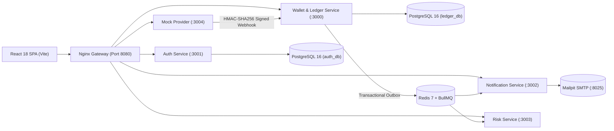

# Payora (৳) - Digital Wallet & Double-Entry Ledger Engine

[](https://github.com/ZamanAsad007/Payora/actions/workflows/ci.yml)
[](https://github.com/ZamanAsad007/Payora/actions/workflows/secret-scan.yml)
[](#)
[](#)
[](#7-running-tests)
[](#)

Payora is a **financial-grade digital wallet and double-entry ledger platform** inspired by modern mobile financial services (MFS) such as bKash and Nagad. Users hold balances in Bangladeshi Taka (stored as integer **poisha** to avoid floating-point errors), top up funds via a mock payment provider, send peer-to-peer transfers, pay merchants via signed QR codes, and cash out via agent networks.

Built with an obsession for **correctness under high concurrency**: money is mathematically conserved, retries never double-charge, deadlock cycles are impossible, and every single poisha is provably auditable.

> **Disclaimer:** This is an educational and portfolio project. It operates exclusively with **fake money and fake data**. Never input real national identification numbers, real phone numbers, real bank accounts, or payment card details.

---

## Table of Contents

1. [System Architecture](#1-system-architecture)
2. [Double-Entry Ledger Principles](#2-double-entry-ledger-principles)
3. [Transaction Entry Examples](#3-transaction-entry-examples-amounts-in-poisha)
4. [Concurrency Safety & Invariants](#4-concurrency-safety--invariants)
5. [Security & Secret Safety Guardrails](#5-security--secret-safety-guardrails)
6. [Quickstart & Local Setup](#6-quickstart--local-setup)
7. [Running Tests](#7-running-tests)
8. [API Reference](#8-api-reference)
9. [Fee Schedule](#9-fee-schedule)
10. [Design Decisions](#10-design-decisions)
11. [License](#11-license)

---

## 1. System Architecture



### Microservice Roles

| Service | Port | Responsibilities |
|---|---|---|
| **`gateway`** | `8080` | Nginx reverse proxy, security headers, global 10 req/s rate-limiting per IP, and static SPA serving. |
| **`ledger-service`** | `3000` | Double-entry accounts, journal entries, immutable ledger lines, deterministic row locking, P2P transfers, merchant QR payments, cash-out, admin reversals, automated reconciliation, and statement exports (PDF/CSV/JSON). |
| **`auth-service`** | `3001` | User registration, bcrypt password hashing, JWT access + refresh token issuance with rotation, sliding-window refresh, 4–6 digit transaction PIN with 3-attempt brute-force lockout, and device fingerprinting. |
| **`risk-service`** | `3003` | Real-time fraud rule evaluation (velocity spikes, anomalous amounts, first-time payees, untrusted devices) with automatic HIGH-severity account freeze triggers and admin flag review. |
| **`notification-service`** | `3002` | Multi-channel event dispatcher: in-app inbox, Mailpit SMTP emails, and mock SMS. All outgoing messages apply strict phone number PII masking (`+88017****5678`). |
| **`mock-provider`** | `3004` | Simulates external banking clearing networks with HMAC-SHA256 signed webhook callbacks, configurable success/failure, and 300-second replay attack tolerance window. |
| **`frontend`** | `5173 / 80` | React 18 SPA (Vite + Tailwind CSS) with TanStack Query, PIN modal flows, transaction receipts, statement generator (PDF/CSV), and full admin dashboard for reconciliation and risk management. |

---

## 2. Double-Entry Ledger Principles

### 2.1 Core Rules

1. **Double-Entry Balance Invariant:** Every financial transaction creates exactly 1 `journal_entry` and ≥ 2 `ledger_lines`. Total Debits must strictly equal Total Credits:

   $$\sum \text{Debits} \equiv \sum \text{Credits}$$

2. **Append-Only Immutability:** Ledger lines can **never** be edited or deleted. Database-level `BEFORE UPDATE OR DELETE` triggers raise an exception on any mutation attempt — even by DB admins.

3. **No Negative Balances:** User and merchant wallets are protected by both PostgreSQL `CHECK (balance >= 0)` constraints and application-level pre-lock balance checks before any entry is posted.

4. **Derivable Balances & Reconciliation:** Account balances are cached for read performance and updated atomically within the same transaction as ledger lines. An automated reconciliation job verifies:
   
   $$\text{Cached Balance} = \sum (\text{Credits} - \text{Debits})$$
   
   across every account in the system, and flags any discrepancy.

5. **Compensating Reversals:** Transactions are **never deleted**. Administrative reversals create a new compensating journal entry with all debit/credit directions swapped, linked to the original via `reverses_entry_id`. The original entry is marked `REVERSED`.

### 2.2 Account Model

| Account Type | Normal Side | Description |
|---|---|---|
| `USER_WALLET` | Liability | User balances available for spending |
| `MERCHANT_WALLET` | Liability | Merchant balances accumulated from customer purchases |
| `SYSTEM_BANK_CLEARING` | Asset | Clearing account representing external funds entering the system via top-up |
| `SYSTEM_FEE_REVENUE` | Revenue | Platform revenue accrued from transfer and cash-out service fees |
| `SYSTEM_AGENT_CASH` | Asset | Clearing account representing physical cash held by the agent network |

---

## 3. Transaction Entry Examples (Amounts in Poisha)

> 100 poisha = ৳ 1.00 BDT

### 3.1 Wallet Top-Up (৳ 500.00 = 50,000 Poisha)
| Account | Direction | Amount |
|---|---|---|
| `SYSTEM_BANK_CLEARING` | **DEBIT** | 50,000 |
| `USER_WALLET` (Alice) | **CREDIT** | 50,000 |

### 3.2 P2P Transfer (৳ 100.00 transfer — ৳ 5.00 flat fee for amounts ≥ ৳ 100)
| Account | Direction | Amount |
|---|---|---|
| `USER_WALLET` (Alice) | **DEBIT** | 10,500 |
| `USER_WALLET` (Bob) | **CREDIT** | 10,000 |
| `SYSTEM_FEE_REVENUE` | **CREDIT** | 500 |

> P2P fees: **Free** for transfers < ৳ 100 (10,000 poisha), **৳ 5.00 flat** for ৳ 100 and above.

### 3.3 Cash Out (৳ 1,000.00 withdrawal — 1.85% agent fee, min ৳ 10)
| Account | Direction | Amount |
|---|---|---|
| `USER_WALLET` (Alice) | **DEBIT** | 101,850 |
| `SYSTEM_AGENT_CASH` (Agent) | **CREDIT** | 100,000 |
| `SYSTEM_FEE_REVENUE` | **CREDIT** | 1,850 |

### 3.4 Merchant Payment (৳ 200.00 — 1% fee, capped at ৳ 50)
| Account | Direction | Amount |
|---|---|---|
| `USER_WALLET` (Alice) | **DEBIT** | 20,200 |
| `MERCHANT_WALLET` (Shop) | **CREDIT** | 20,000 |
| `SYSTEM_FEE_REVENUE` | **CREDIT** | 200 |

### 3.5 Compensating Reversal of a P2P Transfer
| Account | Direction | Amount |
|---|---|---|
| `USER_WALLET` (Alice) | **CREDIT** | 10,500 |
| `USER_WALLET` (Bob) | **DEBIT** | 10,000 |
| `SYSTEM_FEE_REVENUE` | **DEBIT** | 500 |

---

## 4. Concurrency Safety & Invariants

### Transaction Execution Flow

```
BEGIN TRANSACTION (READ COMMITTED)
 1. Check Idempotency-Key (FOR UPDATE).
    └─ If key exists AND request hash matches → return cached response immediately.
    └─ If key exists AND hash differs → throw IDEMPOTENCY_KEY_REUSED_WITH_DIFFERENT_BODY.
 2. Resolve sender, receiver, and fee accounts.
 3. Deterministic Row Locking (prevents deadlocks):
    SELECT id, balance, status FROM accounts
    WHERE id = ANY($account_ids)
    ORDER BY id ASC FOR UPDATE;
 4. Verify: accounts ACTIVE, not FROZEN, balance ≥ amount + fee.
 5. Insert journal_entry and ledger_lines.
 6. Deferred Constraint Trigger: verify SUM(Debits) == SUM(Credits) before commit.
 7. Atomically update cached balances (balance = balance + delta).
 8. Append events to transactional outbox (same DB transaction).
 9. Store response in idempotency_keys table.
COMMIT;
```

### Invariants Proven by Test Suite

| Invariant | Mechanism |
|---|---|
| **Zero-Sum Conservation** | Total assets, liabilities, and revenue always balance. Property-based tests with `fast-check` verify thousands of random transfer combinations. |
| **Negative Balance Prevention** | Concurrent 1,000-transfer storms against accounts with limited funds never produce a negative user balance. |
| **Deadlock Free** | Bi-directional concurrent transfers (A→B and B→A in parallel) complete without DB deadlocks due to `ORDER BY id ASC FOR UPDATE` locking. |
| **Exact-Once Idempotency** | Replaying the same transaction 10× concurrently with the same `Idempotency-Key` creates exactly one journal entry. |
| **Hash Mismatch Detection** | Reusing an `Idempotency-Key` with a different payload throws `IDEMPOTENCY_KEY_REUSED_WITH_DIFFERENT_BODY`. |
| **No Phantom Events** | Transactional outbox ensures events are published if and only if the DB transaction commits. |

---

## 5. Security & Secret Safety Guardrails

| Layer | Guardrail Mechanism |
|---|---|
| **Git / Repo** | Pre-commit hook (`.githooks/pre-commit`) runs `gitleaks` staged scans and filename regex filters. Any staged `.env*` file or secret-like content is blocked and the commit is aborted. |
| **Secrets Policy** | **Zero secrets in code, zero fallback defaults.** `process.env.JWT_SECRET \|\| "default"` is forbidden. All environment variables are validated on boot via Zod schema — missing or weak values cause an immediate hard crash with an informative error. |
| **PII Redaction** | Pino logger auto-redacts PINs, passwords, tokens, and phone numbers from structured log output. All notification channels mask recipient phone numbers (`+88017****5678`). |
| **Authentication** | Two-layer protection: bcrypt-hashed login password **plus** a separate 4–6 digit numeric transaction PIN for all money movements, with 3-attempt lockout and 30-minute cooldown. |
| **Token Security** | Short-lived JWT access tokens (env-configurable) paired with rotating refresh tokens. Each refresh rotation revokes the old token; revoked tokens are rejected immediately. |
| **Network & Web** | Helmet security headers (CSP, HSTS, X-Frame-Options), Nginx 10 req/s IP burst rate limiting with burst queue, and HMAC-SHA256 + timestamp signature verification for all inbound provider webhooks. |

---

## 6. Quickstart & Local Setup

### 6.1 Prerequisites

- **Docker Engine** ≥ 24 & **Docker Compose** v2
- **Node.js** ≥ 20.x (for running tests locally)
- **Git** (with `.githooks/` pre-commit hooks installed)

### 6.2 One-Command Launch (Recommended)

Using **Make**:
```bash
# Setup environment, build cluster, apply migrations, and seed demo accounts
make dev
```

Or using **npm / Docker Compose** directly:
```bash
# 1. Install Git pre-commit security hooks
git config core.hooksPath .githooks

# 2. Configure environment with securely generated cryptographic keys
cp .env.example .env
npm run generate:secrets

# 3. Spin up the full microservice cluster
docker compose up --build -d

# 4. Run database schema migrations & seed demo accounts
npm run migrate
npm run seed
```

### 6.3 Demo Login Credentials & Seed Data

All accounts are pre-seeded with fake funds in Bangladeshi Taka (stored as minor units in poisha):

| Role | Name | Phone Number | Password | PIN | Initial Balance | Details / Purpose |
|---|---|---|---|---|---|---|
| **User** | Alice Rahman | `01700000001` | `Password123!` | `1234` | ৳ 5,000.00 | Primary demo user (P2P send, QR pay, cash out) |
| **User** | Bob Hossain | `01700000002` | `Password123!` | `4321` | ৳ 2,000.00 | Saved payee of Alice (P2P recipient / transfers) |
| **Merchant** | SuperMart Dhaka | `01700000003` | `Password123!` | `9876` | ৳ 10,000.00 | Merchant Code: `00000000-0000-0000-0000-000000000001` |
| **Agent** | Karim Agent Point | `01700000004` | `Password123!` | `5555` | ৳ 50,000.00 | Destination agent for Cash-Out operations |
| **Admin** | Admin Auditor | `01700000000` | `Password123!` | `0000` | ৳ 50,000.00 | Unlocks the `/admin` dashboard (reconciliation, freeze, reversals) |

> 💡 The login screen also features 1-click **Quick Demo Account** buttons to instantly populate credentials!

### 6.4 Make Command Reference

| Command | Description |
|---|---|
| `make dev` | All-in-one bootstrap: `init` + `up-build` + `migrate` + `seed` |
| `make up` / `make up-build` | Launch microservice cluster in detached mode |
| `make down` | Stop running containers |
| `make down-v` / `make clean` | Stop containers and wipe persistent PostgreSQL & Redis volumes |
| `make status` / `make ps` | Check health and status of all containers |
| `make logs` | Stream real-time logs across all services |
| `make logs-<service>` | Stream logs for specific service (e.g. `logs-gateway`, `logs-ledger`, `logs-auth`, `logs-db`) |
| `make migrate` | Execute pending database migrations |
| `make seed` | Re-populate demo users, merchant, agent, and initial balances |
| `make test` | Run complete unit, property, and concurrency test suite (135 tests) |
| `make test-guardrails` | Verify pre-commit gitleaks & secret prevention checks |
| `make shell-db` | Open interactive PostgreSQL `psql` console |
| `make shell-redis` | Open interactive Redis CLI |

### 6.5 Service URLs

| Service | URL |
|---|---|
| **Web Application (SPA)** | http://localhost:8080 |
| **API Gateway** | http://localhost:8080/api |
| **Mailpit Email UI** | http://localhost:8025 |
| **Ledger API (direct)** | http://localhost:3000 |
| **Auth API (direct)** | http://localhost:3001 |
| **Notification API (direct)** | http://localhost:3002 |
| **Risk API (direct)** | http://localhost:3003 |
| **Mock Provider (direct)** | http://localhost:3004 |

### 6.4 Environment Variables

Copy `.env.example` to `.env` and run `npm run generate:secrets` to auto-populate all cryptographic keys. See [`.env.example`](.env.example) for all required variables and descriptions.

| Variable | Description |
|---|---|
| `JWT_SECRET` | HS256 signing key (min 32 chars) |
| `JWT_ACCESS_EXPIRY` | Access token lifetime (e.g. `15m`) |
| `JWT_REFRESH_EXPIRY_DAYS` | Refresh token TTL in days |
| `WEBHOOK_SECRET` | HMAC-SHA256 key for provider callbacks |
| `DATABASE_URL` | PostgreSQL connection string (ledger DB) |
| `AUTH_DATABASE_URL` | PostgreSQL connection string (auth DB) |
| `MERCHANT_QR_SECRET` | Key for signing merchant QR payloads |

---

## 7. Running Tests

Payora features a comprehensive test suite: **135 tests across all microservices**, covering unit logic, property-based generative testing (fast-check), HTTP integration tests (Supertest), and multi-threaded concurrency simulations.

```bash
# Run the complete test suite across all microservices
npm test

# Run tests for a specific service
npm test --workspace=@payora/ledger-service
npm test --workspace=@payora/auth-service
npm test --workspace=@payora/notification-service
npm test --workspace=@payora/risk-service
npm test --workspace=@payora/mock-provider

# Run property-based ledger invariant tests (fast-check)
npm run test --workspace=@payora/ledger-service -- --testPathPattern=property

# Run parallel transfer and deadlock concurrency suite
npm run test --workspace=@payora/ledger-service -- --testPathPattern=concurrency

# Verify Git pre-commit secret guardrails work correctly
npm run test:guardrails
```

### Test Coverage Summary

| Service | Test Suites | Tests |
|---|---|---|
| `auth-service` | 3 | 20 |
| `ledger-service` | 17 | 98 |
| `mock-provider` | 1 | 4 |
| `notification-service` | 1 | 6 |
| `risk-service` | 1 | 7 |
| **Total** | **23** | **135** |

---

## 8. API Reference

### Auth Service (`/api/auth`)

| Method | Endpoint | Description | Auth |
|---|---|---|---|
| `POST` | `/api/auth/register` | Register new user and auto-create wallet | None |
| `POST` | `/api/auth/login` | Login with phone + password, returns JWT pair | None |
| `POST` | `/api/auth/refresh` | Rotate refresh token and issue new access token | None |
| `POST` | `/api/auth/logout` | Revoke refresh token | None |
| `POST` | `/api/auth/pin` | Set or change transaction PIN | Bearer JWT |
| `POST` | `/api/auth/pin/verify` | Verify transaction PIN (with brute-force lockout) | Bearer JWT |

### Ledger Service (`/api`)

| Method | Endpoint | Description |
|---|---|---|
| `POST` | `/api/transfers` | P2P transfer (requires `Idempotency-Key` header) |
| `POST` | `/api/top-up/initiate` | Initiate wallet top-up via mock provider |
| `POST` | `/api/provider/webhook` | Receive signed webhook callback from mock provider |
| `POST` | `/api/cash-out` | Cash out via agent network |
| `POST` | `/api/payments/merchant` | Pay a merchant via ID or QR payload |
| `POST` | `/api/merchants` | Register a new merchant |
| `GET` | `/api/merchants/:id` | Get merchant details |
| `GET` | `/api/payees` | List saved payees |
| `POST` | `/api/payees` | Add or update a saved payee |
| `DELETE` | `/api/payees/:id` | Remove a saved payee |
| `GET` | `/api/statements` | Download account statement (`?format=pdf\|csv\|json&from=&to=`) |
| `GET` | `/api/wallet` | Get wallet balance and account info |
| `GET` | `/api/transactions` | List transaction history |
| `POST` | `/api/admin/transactions/:id/reverse` | Admin: reverse a transaction |
| `PATCH` | `/api/admin/accounts/:id/freeze` | Admin: freeze an account |
| `PATCH` | `/api/admin/accounts/:id/unfreeze` | Admin: unfreeze an account |
| `GET` | `/api/admin/stats` | Admin: system-wide statistics |
| `POST` | `/api/admin/reconciliation/run` | Admin: trigger manual reconciliation |
| `GET` | `/api/admin/reconciliation` | Admin: get latest reconciliation report |
| `GET` | `/api/admin/audit-logs` | Admin: paginated audit log |

### Risk Service (`/api/risk`)

| Method | Endpoint | Description |
|---|---|---|
| `POST` | `/api/risk/evaluate` | Evaluate a financial event against fraud rules |
| `GET` | `/api/risk/flags` | List risk flags (filterable by status/severity/userId) |
| `POST` | `/api/risk/flags/:id/review` | Admin: clear or confirm a risk flag |

### Notification Service (`/api/notifications`)

| Method | Endpoint | Description |
|---|---|---|
| `POST` | `/api/notifications/dispatch` | Dispatch multi-channel notifications for a financial event |
| `GET` | `/api/notifications/in-app/:userId` | Get user's in-app notification inbox |
| `PATCH` | `/api/notifications/:id/read` | Mark a notification as read |

---

## 9. Fee Schedule

| Transaction Type | Fee Rule |
|---|---|
| **P2P Transfer** | Free for amounts < ৳ 100; flat **৳ 5.00** (500 poisha) for ৳ 100 and above |
| **Cash Out** | **1.85%** (185 basis points) of withdrawal amount; minimum **৳ 10.00** (1,000 poisha) |
| **Merchant Payment** | **1.00%** (100 basis points); maximum capped at **৳ 50.00** (5,000 poisha) |
| **Wallet Top-Up** | No fee (provider charges handled externally) |
| **Transaction Reversal** | No additional fee (compensating entry only) |

> All fees are computed using **pure integer basis-point arithmetic** — no floating-point division is ever used in fee calculations.

---

## 10. Design Decisions

### Why Integer Poisha instead of Floats?
Floating-point arithmetic ($0.1 + 0.2 \neq 0.3$) creates unacceptable rounding leakage in financial software. Storing integer minor units (`BIGINT` poisha, where 100 poisha = 1 Taka) guarantees 100% precision. All fee calculations use pure integer basis-point arithmetic.

### Why Double-Entry Accounting?
Single-balance updates (`balance = balance - 100`) lose provenance — there's no audit trail showing *where* the money went. Double-entry ensures that money can never appear or disappear without a balancing counterparty line. Every poisha is traceable from creation to destruction.

### Why Deterministic Row Locks over Optimistic Locking?
Optimistic locking (`WHERE version = 1`) suffers catastrophic retry-storm degradation under high contention (e.g. a popular merchant account). Ordered pessimistic locks (`ORDER BY id ASC FOR UPDATE`) serialize transfers cleanly with **zero deadlocks** and predictable throughput.

### Why Transactional Outbox?
Emitting events (to Redis/BullMQ) inside the same PostgreSQL transaction as ledger lines prevents two failure modes:
- **Ghost events:** an event is published but the DB transaction rolls back
- **Lost events:** the DB commits but a network failure drops the event

The outbox table is committed atomically with ledger entries; a background publisher then delivers them.

### Why bcrypt for PINs?
Transaction PINs are 4–6 digit numerics — a small keyspace. bcrypt's work factor provides meaningful brute-force resistance (each hash attempt is intentionally slow), and the 3-attempt lockout with 30-minute cooldown further limits online attacks.

### Why Fail-Fast Environment Validation?
Weak or missing secrets (e.g. a default JWT secret) are a critical security failure that could silently compromise production. Validating all variables on startup via Zod schema causes an immediate crash with a clear error message, making misconfiguration impossible to ignore.

---

## 11. License

This repository is licensed under **UNLICENSED**. All rights reserved. © 2026 ZamanAsad007.
