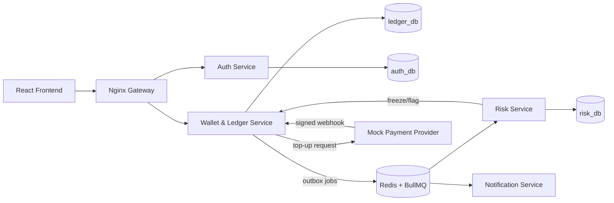

# Payora System Architecture

Payora is a high-concurrency, double-entry financial ledger and wallet platform.

## Architecture Overview

## Core Principles

1. **Double-Entry Ledger:**
   - Every transaction consists of balanced journal entries: $\sum \text{Debits} = \sum \text{Credits}$.
   - Ledger lines are append-only. Never updated or deleted.
   - Mistakes are reversed via compensating journal entries.

2. **Concurrency Safety & Idempotency:**
   - Account locks are always acquired in deterministic order (`ORDER BY id ASC FOR UPDATE`) to eliminate deadlocks.
   - All money-moving endpoints require an `Idempotency-Key` header with payload hashing.

3. **Precision & Money Math:**
   - All monetary amounts are stored and calculated as integers in minor units (poisha), avoiding IEEE 754 floating-point inaccuracies.

4. **Security & Guardrails:**
   - Fail-fast configuration validation with Zod.
   - Pre-commit and CI secret scanning with Gitleaks.
   - Push protection and strict credential isolation.
