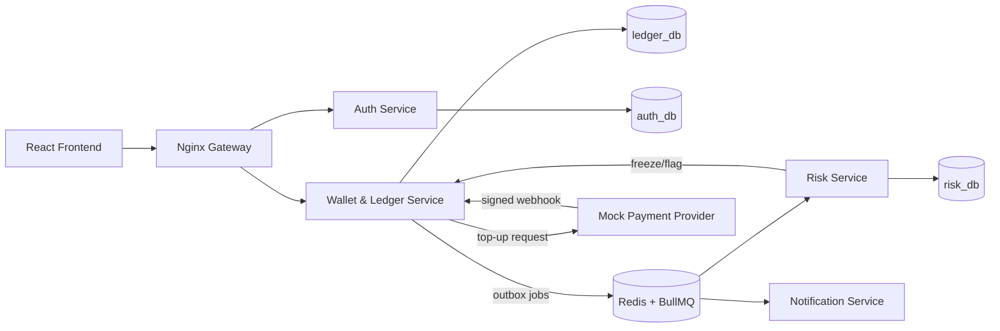

# Payora System Architecture

Payora is a high-concurrency, double-entry financial ledger and wallet platform.

## Architecture Overview

## Core Principles

1. **Double-Entry Ledger:**
   - Every transaction consists of balanced journal entries: $\sum \text{Debits} = \sum \text{Credits}$.
   - Ledger lines are append-only. Never updated or deleted.
   - Mistakes are reversed via compensating journal entries.

2. **Concurrency Safety & Idempotency:**
   - Account locks are always acquired in deterministic order (`ORDER BY id ASC FOR UPDATE`) to eliminate deadlocks.
   - All money-moving endpoints require an `Idempotency-Key` header with payload hashing.

3. **Precision & Money Math:**
   - All monetary amounts are stored and calculated as integers in minor units (poisha), avoiding IEEE 754 floating-point inaccuracies.

4. **Security & Guardrails:**
   - Fail-fast configuration validation with Zod.
   - Pre-commit and CI secret scanning with Gitleaks.
   - Push protection and strict credential isolation.

## Microservices Breakdown

### 1. Ledger Service (Core)
- **Double-Entry Engine:** Balanced debit/credit posting with deferred constraint triggers.
- **Transfers & Top-Up:** Idempotent P2P transfers and provider webhook integration.
- **Merchant Payments & Cash-Out:** Server-signed QR code verification, 1% merchant fee (capped at 50 BDT), and 1.85% agent cash-out fee.
- **Payees:** Saved user contacts with nickname and unique counterparty mapping.
- **Transactional Outbox:** Atomic insertion of domain events in the same database transaction as financial ledger lines.
- **Spending Limits & Account Controls:** Dynamic per-transaction, daily, and monthly limit enforcement, and account freeze/unfreeze administration.
- **Statements Export:** RFC 4180 compliant CSV and professional PDF statements generated with running balance calculation.

### 2. Risk Service
- **Rule Engine:** Real-time evaluation of velocity spikes (>5 transfers in 2 minutes), unusually large amounts (>= 20,000 BDT), new payee high-value transfers (>= 5,000 BDT), and untrusted devices.
- **Automated Hold Action:** Immediate trigger of temporary account freeze on HIGH severity fraud flags.
- **Review Workflow:** Admin review endpoints for flag clearance and confirmation.

### 3. Notification Service
- **Multi-Channel Dispatcher:** In-App, Email (Mailpit SMTP), and Mock SMS for financial and security events.
- **Privacy Protection:** Automatic phone number masking across all message templates, notifications, and logs (e.g. `+88017****5678`).
- **In-App Inbox:** User notification retrieval and read status tracking.

### 4. Mock Payment Provider
- Simulates external MFS/banking top-ups with HMAC-SHA256 signature verification and replay prevention.

